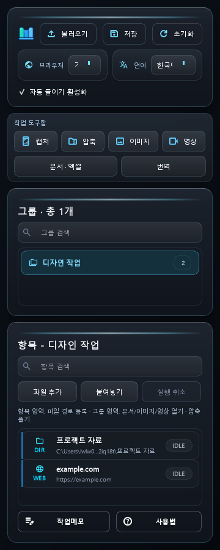
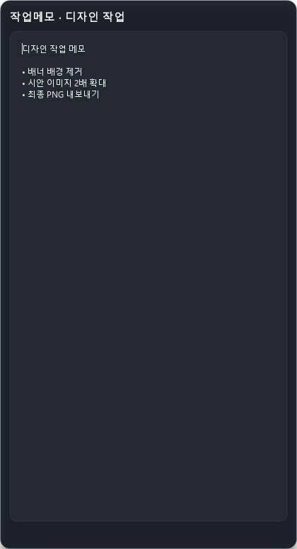
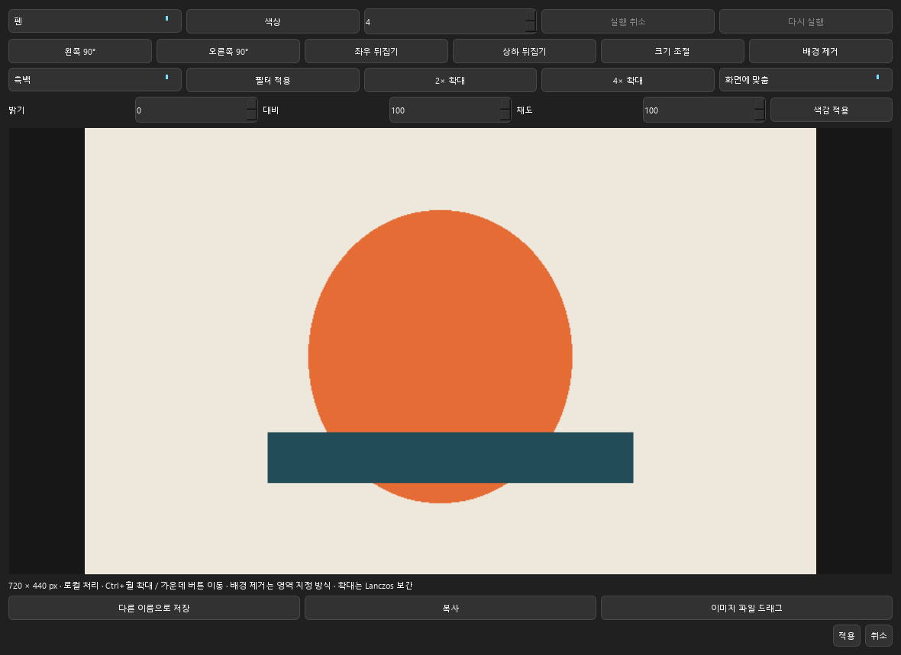

# 모아독 / MoaDock

프로그램·폴더·파일·웹사이트를 작업그룹으로 모아 실행하고 캡처·문서·이미지·영상 작업을 한곳에서 이어가는 Windows 데스크톱 앱입니다.

**공식 실행 파일 배포·안내 저장소입니다. MoaDock 자체 소스코드는 비공개이며 이 저장소에 포함되지 않습니다.** 개인·기업에서 무료로 사용할 수 있습니다. 오픈소스 앱으로 배포하는 것은 아니며 외부 구성요소에는 별도의 라이선스가 적용됩니다.

## 다운로드

[**Windows x64 실행 ZIP 다운로드**](https://github.com/c01021322969-lang/MoaDock-Releases/releases/download/v0.1.2-beta/MoaDock-v0.1.2-beta-windows-x64.zip) · [릴리스 설명](https://github.com/c01021322969-lang/MoaDock-Releases/releases/tag/v0.1.2-beta)

- [외부 라이브러리 대응 소스 ZIP](https://github.com/c01021322969-lang/MoaDock-Releases/releases/download/v0.1.2-beta/MoaDock-third-party-sources-20261025.zip) — MoaDock 코드가 아닌 Qt/PySide6·7-Zip·FFmpeg 등 외부 구성요소 소스입니다.
- [SHA256SUMS.txt](https://github.com/c01021322969-lang/MoaDock-Releases/releases/download/v0.1.2-beta/SHA256SUMS.txt) — 실행 ZIP·외부 소스 ZIP·별도 고지 파일의 무결성 확인값입니다.

ZIP 전체를 쓰기 가능한 새 폴더에 풀고 `MoaDock.exe`를 실행하세요. **Python 설치는 필요하지 않습니다.** `_internal` 폴더를 포함한 전체 구성을 유지해야 합니다. 기존 사용자는 설정·메모를 백업하고 기존 앱을 트레이에서 종료한 뒤 새 폴더에서 확인하세요.

녹화·MP4 편집·다운로드용 `ffmpeg.exe`와 `ffprobe.exe`는 포함하지 않습니다. 해당 기능을 사용하려면 [FFmpeg](https://ffmpeg.org/download.html)를 별도로 설치해 PATH에 추가하세요. 영상 재생용 Qt FFmpeg DLL은 포함되어 있습니다.

코드 서명되지 않은 초기 베타입니다. Windows 또는 보안 소프트웨어의 경고가 표시될 수 있습니다. 공식 릴리스와 체크섬을 확인하고 조직 보안 정책을 따르세요.

## v0.1.2 Beta 업데이트

- 영상 재생·편집을 같은 창으로 통합하고 자르기·구간 삭제·배속·MP4 저장과 저장 전 미리보기를 추가했습니다.
- 편집 결과를 드래그할 MP4를 자동 준비하며, 다시 편집하면 이전 변환을 취소합니다.
- 영상만 전체 화면과 외부 자막·표시 설정 저장을 지원합니다.
- 현재 브라우저의 개별 영상 다운로드와 URL 입력 다운로드를 추가했습니다. TikTok 추천 피드에서는 공유 링크를 URL 입력란에 붙여넣으세요.
- [릴리스 전체 변경·제한·첨부 파일](https://github.com/c01021322969-lang/MoaDock-Releases/releases/tag/v0.1.2-beta)

## v0.1.1 Beta 수정 사항

- 연결된 각 모니터에서 영역 캡처를 시작할 수 있도록 수정했습니다.
- 문서·시트 인쇄 글씨 크기와 인쇄 미리보기 종료 오류를 수정했습니다.
- 자동 검사 146개와 Windows 미리보기 반복 검사를 통과했습니다. 실제 두 번째 모니터와 종이 출력은 추가 확인이 필요합니다.

## 화면 미리보기

개인정보 없는 합성 자료를 사용한 실제 앱 UI 렌더링입니다. 이미지를 클릭하면 원본 크기로 볼 수 있습니다.

<table>
<tr><td align="center"><strong>작업 독</strong></td><td align="center"><strong>그룹별 작업메모</strong></td></tr>
<tr><td valign="top"></td><td valign="top"></td></tr>
</table>

### 이미지 에디터

## 주요 기능

- 작업그룹별 등록·개별/그룹 실행, 검색·즐겨찾기·최근 항목, 일괄 경로 등록과 그룹별 메모
- 마지막 창 크기·위치 복원, 사용자 작업 후 자동 축소, 아이콘에서 전면 복원
- 전체 화면·영역·창 캡처, 겹친 창 휠 선택, 수동 아래 방향 스크롤 캡처
- 이미지 주석·도형·텍스트·모자이크·자르기·회전·뒤집기·색감·필터·지우개·실행 취소
- 영역 지정 GrabCut 배경 제거와 Lanczos 2배·4배 확대
- 화면·영역 MP4 녹화, 포인터 효과와 선택적 클릭 효과음
- 같은 창의 영상 재생·편집 모드, 자르기·구간 삭제·배속·MP4 저장, 편집 결과 미리보기와 자동 MP4 드래그 준비
- Enter/F11 영상 전용 전체 화면, 외부 SRT/SMI/VTT 자막·위치·크기 설정 저장
- [현재 브라우저 영상 다운로드](BROWSER_DOWNLOAD.md): YouTube·TikTok·Instagram 개별 영상 주소 또는 URL 입력
- 문서·엑셀 탭, 본문·셀·수식 수정, 검색·복사본 저장·인쇄·미리보기
- ZIP 생성, ZIP/7Z/RAR 해제, 해제 결과 전체 복사·이동
- 이미지·영상 파일 드래그 내보내기, 17개 언어 사용법과 언어·국가명 검색
- 사용자 확인 버튼으로 선택 내용을 Google 웹 번역기에 전달

## 드롭 위치에 따른 동작

| 위치 | 동작 |
|---|---|
| 항목 영역 | 파일 종류와 관계없이 현재 그룹에 경로 등록 |
| 그룹 영역 | 지원 문서·이미지·영상 열기 또는 압축 해제 |
| 축소 아이콘 아래→위 진입 | 경로 등록 |
| 축소 아이콘 좌우 진입 | 열기·압축 해제 |

## 지원 범위와 제한

- HWP 5는 본문 추출·편집 후 TXT/DOCX 저장이며 HWP 재저장은 하지 않습니다.
- HWPX는 기존 텍스트 영역 수정, DOCX는 본문 중심 편집입니다. 원래의 복잡한 조판을 완전히 재현하지 않습니다.
- PDF는 기존 페이지 위 텍스트·형광 표시 추가입니다. 본문 재배치·OCR은 지원하지 않습니다.
- XLSX 수식은 보존·편집하지만 자체 재계산하지 않습니다. XLS는 값 중심으로 XLSX에 변환합니다.
- 배경 제거·확대는 AI 모델 기반 처리가 아닙니다. 영상 편집은 자르기·구간 삭제·배속과 MP4 저장을 제공합니다. 자막·추가 음성 트랙은 출력에 보존하지 않습니다.
- 스크롤 캡처는 직접 아래로 스크롤하고 Esc로 완료합니다. 자동 스크롤이 아닙니다.
- 녹화는 기본 무음입니다. 마이크·PC 소리는 녹음하지 않으며 사전 활성화한 클릭 효과음만 선택 포함합니다.
- 번역은 인터넷이 필요한 외부 Google 웹 연결이며 사용자가 확인한 텍스트를 전송합니다.
- 암호화·분할 압축, macOS, MCP/API, 클라우드 동기화는 지원하지 않습니다.
- 실제 프린터 출력은 미검사이며 일부 검사 환경에서 캡처 화면이 검게 반환된 한계가 있습니다. 모든 코덱·혼합 DPI·보호 화면 동작을 보장하지 않습니다.

## 검증

최신 영상·도구함 관련 자동 검사 83개, 배포 실행 파일 자체 진단, ZIP 무결성 및 체크섬 검사를 통과했습니다. 다른 PC의 실제 사용 검증과 자동 진단은 구분합니다. 사용자 설정·메모·개인 문서·캡처 결과는 포함하지 않았습니다.

## 사용 조건과 외부 구성요소

[무료 사용 조건](LICENSE.txt) · [제3자 고지](THIRD_PARTY_NOTICES.md) · [대응 소스 안내](SOURCE-ACCESS.md) · [라이브러리 교체](LIBRARY_REPLACEMENT.md)

외부 구성요소의 수정·교체·재연결 및 그 디버깅에 필요한 역공학 권리는 제한하지 않습니다. 실행 ZIP을 재배포할 때에는 사용 조건·제3자 고지·외부 대응 소스도 함께 제공하세요.

## 제보와 소개

[Issues](https://github.com/c01021322969-lang/MoaDock-Releases/issues)에 Windows 버전·재현 순서·오류 메시지를 남겨 주세요. 개인정보와 문서 내용은 제거해 주세요.
실제 앱 화면을 활용한 리뷰·튜토리얼·수익화 영상 소개를 허용합니다. 공식 제품 사칭은 허용하지 않습니다.

YouTube 다운로드에는 Node.js 등 지원되는 JavaScript 런타임이 필요할 수 있습니다. TikTok 추천 피드처럼 주소에 개별 영상 ID가 없으면 공유 링크를 URL 입력란에 붙여넣으세요. 로그인·지역·사이트 정책에 따른 제한이 있습니다. 브라우저 쿠키를 자동 수집하지 않습니다.
